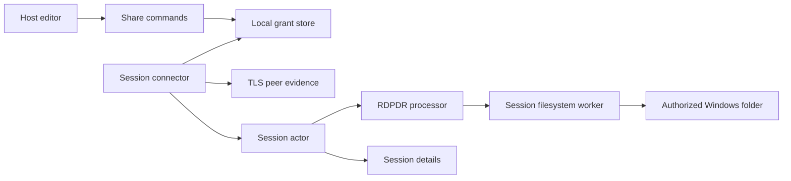

# RDP folder sharing design

## Overview

A Windows user chooses one local folder for a saved host. Remote applications read it through an ordinary RDPDR redirected drive. With an explicit read/write grant, they can also create, copy, rename and delete files. The remote OS decides where the drive appears. One grant covers a folder, one server identity and one host profile.

### Goals and non-goals

Deliver ordinary copies from Windows tools and Linux shells, enforce the selected scope on the workstation, and measure the effect of copying on typing. Native Linux/macOS clients, remote mount provisioning, live grant changes, a parallel-copy command and workspace synchronization have separate delivery decisions.

## Boundary Commitments

| Boundary | Commitment |
|---|---|
| This Spec Owns | Host grant UI and storage, Windows folder confinement, RDPDR connection lifecycle, observable access state and transfer acceptance evidence. |
| Out of Boundary | Server policies, filesystem mount names, credential probes, graphics codecs and copy-tool retry or partial-file policy. |
| Allowed Dependencies | Existing Rust connector, active session actor, atomic store writer, Windows filesystem APIs, IronRDP protocol/native backend and the common TLS peer-verification contract. Each feature can consume peer verification independently. |
| Revalidation Triggers | Changes to certificate or grant identity, connector channel negotiation order, native root handling, completion tracking, server software/policy or benchmark methodology. |

## Architecture

The existing actor owns the encrypted stream, display, input and static-channel framing. The Windows backend owns filesystem handles. The frontend receives typed summaries. File contents stay on the Rust/RDP path. The existing Transport RX/TX counters remain the source of whole-session bandwidth measurements.

### File structure plan

| Changes | Owner and contract |
|---|---|
| Extend `src/components/connections/HostProfileFields.tsx`, `ConnectionForm.tsx`, `src/lib/tauri.ts`, `src/types.ts` | Host editor, native selection, explicit confirmation, next-connection indicator and session share details in the existing UI. |
| Add `src-tauri/src/commands/folder_share.rs` and `src-tauri/src/store/share_grants.rs` | Native folder picker, grant read/confirm/revoke, serialized atomic writes via `store/atomic_write.rs`. Register using the existing module declarations and Tauri command handler. |
| Extend `src-tauri/src/commands/connection.rs`, `commands/library.rs` and `commands/deletion.rs` | Coordinate host edits, imports and single/cascaded deletion with grant invalidation. Preserve the current behavior of unshared hosts. |
| Shared `src-tauri/src/rdp/peer_identity.rs`, extend `rdp/client.rs` | Return same-socket authenticated peer evidence before CredSSP and attach a drive only after matching the grant. Coordinate this one module with session actions. |
| Add `src-tauri/src/rdp/folder_share.rs`, extend `rdp/session.rs` and `src/components/layout/StatusBar.tsx` | Bounded I/O, root lifetime, completion evidence and teardown. Surface status in the existing details/menu without another bar. |
| Extend `src-tauri/Cargo.toml` and lockfile | Select compatible exact RDPDR protocol/native versions, native dependency under Windows, and the native folder picker API. Preserve the current IronRDP type train. |
| Add spec-local `validation.md` at execution | Record actual clients, servers, file results and interactive performance. Large fixtures and raw measurements belong under the configured project build-artifact directory. |

## System flows and data models

1. **Authorize.** The native picker opens a local drive-letter subdirectory for a saved host. Record the volume and directory file ID and display the path. Reject a volume root or an unsupported location explicitly. Show the destination host and port, server key fingerprint, offered name and access mode together. Default to read-only. Use a short portable name (1–7 ASCII letters, digits, underscore or hyphen) so the RDP preferred DOS name round-trips. Bind confirmation to a short-lived native selection and peer evidence. Discard the draft on endpoint edits, cancel or expiry.
2. **Persist.** `ShareGrant { profileId, endpoint, spkiSha256, rootPath, volumeId, directoryFileId, shareName, mode }` lives in a per-user grant file outside the exported library. Save atomically and then publish. Missing, malformed or unreadable grants leave sharing off. New, imported and duplicated profiles have fresh identities and acquire no grant. Invalidate an old binding on a destination change or deletion, including cascades. Coordinate grant invalidation with the library mutation so a later address change back, ID reuse or a failed persistence operation cannot silently reactivate it. Moves or display-name edits of the same profile preserve the grant.
3. **Connect.** Run X.224 and TLS on the actual session socket. Require a completed TLS 1.2/1.3 handshake with server signature verification and endpoint validation via trusted chain/name or a separately confirmed host-bound key. Use the intended DNS/IP identity, including IP SANs. Compare SHA-256 of DER SubjectPublicKeyInfo and normalized host/port to the explicit grant. Host trust alone conveys no folder permission. First use or a changed peer requires a new confirmation of host, key and scope. A credential-free discovery handshake can supply the fingerprint for independent verification. Never derive a shared-session identity from the current permissive verifier or reuse identity from a prior socket.
4. **Attach.** Before `connect_finalize` consumes the connector, bind the root and attach the single static `Rdpdr` only on a match. Channel names are encoded by the later MCS/GCC exchange. Off, unverified and inaccessible cases therefore disclose neither a folder nor a device name. A sharing failure alone leaves a separately permissible desktop connection available. A failed TLS/authentication check follows the connection's own credential policy.
5. **Use and stop.** Negotiate RDPDR, announce one device, receive the server’s result, then serve its requests. Configuration changes apply on next connect. Existing sessions show their effective mode and “Disconnect to end access now.” Reconnect creates a fresh session generation, rechecks the current grant and peer, and starts with empty handle and completion tables.

## Components and interfaces

**Folder grant commands.** `get_folder_share(profileId)` returns committed state. `select_share_folder(profileId)` opens the native picker and returns a display path and opaque selection ID. `confirm_folder_share(profileId, selectionId, peerEvidenceId, shareName, mode)` validates both native-owned selections against the current endpoint under the same mutation lock. `revoke_folder_share(profileId)` is idempotent. Missing grants require no migration of existing libraries. When persistence fails, display the last committed state. Before a retarget, revoke the grant durably under the mutation lock. A crash after revocation can require fresh consent for the original endpoint. On deletion, clean the grants for the IDs actually removed and require fresh client-generated IDs on import/duplicate.

For a self-signed server, use the shared **Review server identity** action and endpoint pin store owned by `rdp/peer_identity.rs`. Keep the pin outside exported profiles. An operator can verify a host for credential testing without selecting a folder. Granting folder access then requires its own explicit confirmation. On a key change, reviewing the new pin and renewing the folder grant are separate steps. [Credential probe design](../rdp-session-actions/design.md)

**Windows file access.** Start with `RedirectedDrive::new(device_id, name, root_path, read_only)`, a single-drive `WindowsRdpdrBackendFactory` and `Rdpdr::with_drives`. Leave logical-drive discovery, hotplug and other device classes off. The published native backend validates paths and opens descendants handle-relative but reopens its root by NT path. Bind the granted volume/file ID using a live, no-reparse directory handle. Prefer an upstream extension that accepts this handle and duplicates it for traversal. An application adapter is viable only if it pins the complete no-reparse ancestor chain against rename/delete, verifies the stored ID under those handles and keeps them through the last I/O. A path check followed by an unlocked reopen leaves a race. If neither integration passes the Windows confinement tests, withhold the share.

**Bound root (implemented in task 4.1).** While a drive is attached, the root and every ancestor are held by read/traverse handles that deny delete sharing, so the native reopen by NT path keeps reaching the granted directory. NTFS already refuses to move a folder that contains an open file. A local program can still move an individual file or folder the remote has open, if the remote opened it with delete sharing. That handle stays usable until closed, and every new open resolves from the bound root (user decision 2026-11-18).

With every guard held, binding checks each component again and requires the root to resolve to the granted path, so a substituted drive letter or a short name does not bind. A program running as the same user can still remap the drive letter with `DefineDosDevice` after binding. That is out of scope: such a program already has the user's access to every file. Files with more than one hard link are read-only through the share, counted through a stream name to its file; when the count cannot be read, the change is refused, and so is a rename that replaces such a file. Remote hard-link creation cannot occur, because ironrdp-rdpdr 0.9 does not decode FileLinkInformation.

**Several folders (user request 2026-11-19).** A host may share up to eight folders, each under its own share name, and each can be stopped on its own. The grant file is version 2, a list per host; version 1 files are read and rewritten as version 2 on the next change. The same directory cannot be shared twice with one host. Each folder is verified (address, reviewed key) and bound on its own at connect; those that pass become drive devices of one RDPDR channel and one worker, with consecutive device IDs from the first named-drive ID, and each has its own status in the session details.

**Share policy (task 4.2).** `ShareBackend` sits in front of the native backend. The native backend enables SeSecurityPrivilege for SACL access and the backup or restore privilege for backup-intent security, so `ShareBackend` answers those requests with STATUS_PRIVILEGE_NOT_HELD in both modes before they reach it. Read-only mode is the native backend's own, which refuses mutating opens, writes, set-information, security changes and object-ID creation with STATUS_MEDIA_WRITE_PROTECTED and unknown control codes with STATUS_NOT_SUPPORTED. Everything else runs with the workstation user's ordinary rights.

Use the ordinary workstation token. Deny requests that would enable privileges, including `ACCESS_SYSTEM_SECURITY`, before native dispatch. Protect the target and its directory chain against outside relocation for the lifetime of every remote file handle, including pending writes and notifications. The released walker drops intermediate handles and permits delete sharing. Retain handle-relative ancestor guards and compatible target share modes, or implement equivalent OS-enforced exclusion. Serialize a permitted in-folder rename against those guards with both parent chains held. If exclusion conflicts with another local opener, return a sharing violation. Verify that normal in-folder rename, close and delete work with this policy.

Keep renames anchored at the destination parent, reject traversal and namespace escapes, and deny operations on the grant root that would remove or rename it. Multiply linked files may be read but never changed: requests that could write, truncate, delete or alter metadata are refused before native dispatch (user decision 2026-11-18; pnpm and uv stores rely on hard links). Reject remote hard-link creation. Enforce read-only at open and at operation dispatch, covering create dispositions, write/append, truncation, delete-on-close, renames, metadata, security descriptors, streams and mutating device controls. Deny unknown mutation paths. Protect writable shares with the same root checks.

**Protocol and I/O.** Use the upstream decoded drive requests, offsets, wire completion types and Windows error mapping. The active actor dispatches ordered work to one filesystem worker per session. Keep native backend state on the worker. Bound queued request count, buffered bytes, handles and reply batch size; size the limits with the typing benchmark. Dispatch and drain without waiting for disk on the input/render loop. Handle synchronous native requests and poll the native deferred completions (locks/notifications). Preserve order for related operations and allow independent requests to be outstanding. A serial local worker is sufficient for the first release.

Track `(session generation, device ID, completion ID)` from ingress to completion, including opcode and payload length. One completion per request carries the original IDs and operation-specific wire shape. Overflow or local failure gets a corresponding resource or filesystem error while the channel is live. Schedule outgoing batches fairly alongside keyboard/display traffic using the existing `process_svc_processor_messages` path. A terminal share error disables that device and resolves pending I/O where the transport permits. On disconnect, stop accepting work, cancel pending operations, close handles, discard late-generation replies and join the worker. On a lost socket, record outstanding operations as interrupted locally. The remote filesystem learns of the lost session. The copying program owns cleanup and retries.

**Status and errors.** Keep desired profile state separate from effective state per session. `Off | PeerConfirmationRequired | LocalFolderUnavailable | Negotiating | Offered | Accepted | AccessObserved | Refused(code) | Unsupported(reason) | Unknown(reason) | Ended` are typed values. Publish “Offered” after the announcement goes on the wire, “Accepted” after the matching server acknowledgement and “Access observed” after a successful directory or file operation completion is written. A failed operation cannot promote status. Keep the latest I/O failure separately. A missing reply, timeout or missing remote mount is inconclusive without an explicit cause. A server refusal does not imply a particular administrative policy. Only the remote tools in acceptance can confirm the mount path.

## Linux and macOS clients (amendment approved 20 November 2026)

Requirement 5. Everything above the filesystem layer is shared with the Windows build: grants, peer verification, attach order, the worker, status and the UI. The filesystem layer changes.

**Upstream backend.** `ironrdp-rdpdr-native` 0.9 includes `NixRdpdrBackend` for Linux and macOS. It splits each server path into validated names (no `..`, `:`, `\` or control characters), opens them one at a time from a directory descriptor with `O_NOFOLLOW`, and refuses symbolic links and mount points (`openat2` with `RESOLVE_NO_SYMLINKS | RESOLVE_NO_XDEV` on Linux 5.6 and later; otherwise a device check, which still lets a bind mount of the same filesystem through). Rename and delete-on-close check DELETE access, and files open with the requested access. Two gaps matter: it has no read-only mode, and it reopens its root by path (`Root::open(file_base)`) on every request, with one root for all drives.

**Bound root on Unix.** At selection, `inspect` rejects `/`, a path whose canonical form differs from the chosen path (a link on the way), and a non-directory, then records `volume_id = st_dev` and `directory_file_id = st_ino` (little endian, zero padded). At connect, `UnixBoundRoot::bind` walks from `/` with `openat(O_DIRECTORY | O_NOFOLLOW)` per component, compares the final descriptor's device and inode with the grant, and keeps the descriptor for the channel's lifetime. The backend's `file_base` is `/proc/self/fd/<n>` on Linux and `/dev/fd/<n>` on macOS, so each reopen reaches the held directory itself whatever happens to its name. Binding reopens that path once and compares the identity again. Unlike the Windows guards, a local rename of the folder is not prevented; it no longer matters, because nothing resolves the old name. A deleted folder makes later requests fail.

**Share policy.** `ShareBackend` and its helpers move out of the Windows-only module. Portable: separator normalization (xrdp), the privilege rule, refusing DELETE on the share root, and the hard-link rule. On Unix the link count comes from walking the server path below the held descriptor with `O_NOFOLLOW` and `fstatat(AT_SYMLINK_NOFOLLOW)` on the last name; only "not found" counts as a new entry, and any other failure refuses the change; directories always count as one link. Read-only mode on Unix is enforced by `ShareBackend`: a create with mutating access, `MAXIMUM_ALLOWED`, delete-on-close, or any disposition other than `FILE_OPEN`, and every write, set-information and set-security request, get STATUS_MEDIA_WRITE_PROTECTED, as the Windows native backend returns. The Windows build keeps the native read-only mode.

**Several folders.** `DriveRouter` holds one `NixRdpdrBackend` per device ID, each with its own `file_base`, and forwards each drive request by its device ID. Reset and deferred polling go to all of them. Device announcement stays `Rdpdr::with_drives`.

**Channels and dependencies.** `ironrdp-rdpdr-native` and `ironrdp-rdpsnd` move from the Windows target table to all targets. The drive channel and the silent audio channel attach on all three platforms. The worker and attach module compile everywhere.

**Folder picker.** Linux and macOS use `tauri-plugin-dialog` 2.8.4 (`blocking_pick_folder`): the XDG desktop portal or GTK on Linux, `NSOpenPanel` on macOS. Windows keeps `IFileOpenDialog`. Choosing a folder in the macOS panel lets the running app open it. After a restart, macOS can ask again for Desktop, Documents, Downloads or removable volumes; a refusal (`EPERM`) leaves the folder out with the pane named (Privacy & Security, Files and Folders).

**Testing.** The Unix policy, binding and routing tests run in the existing Linux CI job and on macOS: the read-only mutation matrix of task 4.2 against the real `NixRdpdrBackend`, a symbolic link in the chosen path, a folder replaced after selection, a folder renamed while bound (requests still reach it), a hard-linked file, two folders isolated from each other, and a copy whose SHA-256 matches. Real-host acceptance from the Linux client covers Windows and xrdp; hypr_rdp does not implement drive redirection.

## Requirements traceability and testing strategy

| Acceptance IDs | Behavior | Evidence before release |
|---|---|---|
| 1.1, 1.2, 1.3 | Grant lifecycle and effective session settings | Existing/import/duplicate profiles off, both access modes, cancel/save failures, disconnect to revoke and subsequent reconnect. |
| 1.4 | Peer permission bound to this connection | Trusted and explicitly pinned peers, first use, changed endpoint/key, bad TLS signature, stale selection, reconnect. Capture the absence of RDPDR registration on withheld sessions. |
| 1.5, 1.6 | Evidence-based share status | Distinguish bad root, refusal, unsupported and unknown. Exercise announcement, acknowledgement, failed reads, successful operation and desktop continuity. |
| 2.1, 2.2, 2.3 | Windows access boundary | Native disposable tree, RO mutation matrix, ordinary ACL/privileged access denial, file/parent reparse, alias, replaced root/ancestor and rename destination. Try relocating the target and its parent outside while a remote handle is open and issuing I/O. Check outside sentinels retain contents and metadata. |
| 2.4, 3.4, 3.5 | Request identity, failure and cleanup | Interleaved file IDs/offsets, full queue, local I/O failure, disconnect mid-write, repeated reconnect and concurrent sessions. Check contents, each completion, missing success on failure, worker termination and handle release. |
| 3.1, 3.2, 3.3 | Standard copy semantics | Directory list/create, 0-byte file, short reads/EOF, sparse fixture with data above 4 GiB, write/flush/close, rename/delete and denied local writes using normal remote programs. |
| 4.1, 4.2 | Real-host matrix | Windows client against Windows workstation and the actual FreeRDP-based and IronRDP-based Linux deployments. Record server product/build and redirection policy, offered name, observed UNC/mount, RO denial and RW hashes in both directions. Use PowerShell/Explorer and Linux `findmnt`, `ls`, `cp`, `mv` and `rm` in disposable folders. Record accepted, refused, unsupported or inconclusive with evidence per host. |
| 5.1–5.7 | Linux and macOS clients | Unix tests listed in the amendment above, in Linux CI and on macOS; real-host matrix from the Linux client against Windows and xrdp. |
| 4.3, 4.4 | Bandwidth and segmented-copy decision | Benchmark as below. A segmented experiment is conditional on a measured opportunity and independently schedulable remote requests. |

**Benchmark.** Hold host, client build, resolution, graphics profile, network path/RTT/rate, dataset and source/destination media constant. Record copy tool, direction, cache conditions and repeated trials for a large file, a tree of source files and a matching no-copy typing baseline. Report elapsed time, logical payload, session RX/TX deltas, throughput, peak outstanding requests and input-to-visible-echo median/p95. Verify SHA-256 and a relative-path manifest in both directions. If justified, compare a one-range control with a small bounded number of disjoint ranges on the same file and RDP session at the same cache state. Verify identical contents, measure actual concurrent requests, and record latency and session bytes as well as elapsed time. Publish the gain or regression for each server before deciding whether to propose a separate copy tool.

**Implementation gates.** First prove the exact dependency lock, root binding and read-only behavior in a Windows fixture. Then verify stage ordering and the deferred I/O bridge under interrupt/overload before attempting live-host acceptance. Keep platform results and benchmark numbers pending until measured.
