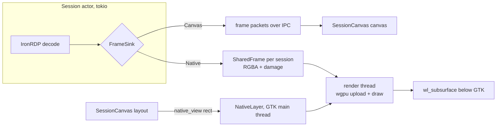

# Design: native renderer for remote frames

## Overview

Remote frames on Linux go to a GPU layer that lives in its own Wayland subsurface below the web view, instead of through the web canvas. The web view becomes transparent where the session picture is, and stays the place for every control, overlay and input. Today's canvas path stays complete and is used whenever the native layer is not available or fails.

What already exists and is reused:

- **`renderer/gpu.rs`**: a wgpu device, a textured full-screen quad (`fullscreen_quad.wgsl`) and texture uploads. It drew into GTK's own surface, which caused [#1](https://github.com/norandom/1-1/issues/1); it moves onto the subsurface and gains a source and destination rectangle.
- **`renderer/shared_frame.rs`**: the session actor already writes every update into a `SharedFrame` (authoritative RGBA plus a dirty flag and a condition variable) when the opt-in renderer runs. It gains a damage rectangle so the render thread uploads only what changed.
- **`probes/native-subsurface`**: the subsurface setup (GDK's `wl_display` and `wl_surface`, `place_below`, desynchronized, empty input region) and the measured gain ([results](../../../probes/native-subsurface/results-2026-11-21.md)).
- **`src/lib/canvas-compositor.ts`**: `layoutSurface` already computes where the picture goes for fit and native modes, scrolling and the device pixel ratio. The native layer receives the same numbers.

## Architecture

### Components

**`display_path` (new, `src-tauri/src/renderer/display_path.rs`)**. A pure function `choose(facts) -> (Path, Reason)` decides between `Native` and `Canvas` from facts collected at startup: the `ONE_ONE_RENDERER` variable, the operating system, whether GDK's display is Wayland (an X11 session and `GDK_BACKEND=x11` both give an X11 display), whether `wl_subcompositor` and `wl_compositor` are advertised, and the outcome of creating the adapter and surface. Each reason is a variant (`ForcedCanvas`, `NotLinux`, `X11Display`, `MissingWaylandInterface(name)`, `NoAdapter`, `SurfaceFailed(text)`, `RuntimeFailure(text)`). The function has no side effects, so every branch is tested without a GPU (requirement 6.4).

**`NativeLayer` (new, `src-tauri/src/renderer/native_layer.rs`, Linux only)**. It owns the Wayland objects and lives on GTK's main thread in a thread-local, as the probe's did, because GTK objects are not `Send`.

- It creates one child surface on GDK's connection and makes it a desynchronized subsurface placed below the toplevel, with an empty input region and a full opaque region.
- **The subsurface covers the whole web view, not only the session area.** It sits at the web view's origin in the toplevel and takes its allocation size, updated from the web view's `size-allocate` signal. The render thread clears it to the app's background color and draws the session picture into the destination rectangle. A page element that is accidentally transparent then shows the background color, not the desktop, and the subsurface position does not depend on the page reporting its geometry in time.
- Position changes are parent state: after `set_position` it calls `queue_draw` on the window so GTK's next commit applies it (probe finding).
- Buffer scale follows `gdk_window_get_scale_factor` (2 at the maintainer's 1.6), which matches what GTK gives the canvas today (requirement 2.3, "as sharp"). If the compositor offers `wp_fractional_scale_v1` and `wp_viewporter`, the layer renders at the exact fractional size and sets the viewport destination to the logical size, which is sharper than the canvas.

**Render thread (`renderer/gpu.rs`, reworked)**. One thread per window, as today (`gpu-render`). It waits on a condition variable shared by the frame stores and the view state, and presents only when something changed (requirement 3.5).

- **Persistent texture.** One RGBA texture holds the visible session's picture. On each wake it takes the damage rectangle from that session's `SharedFrame` (under its lock, copying only that rectangle into a staging buffer), uploads it with `write_texture`, submits, and draws. Writing straight into swapchain images is not used: their content is undefined between frames (probe finding).
- **Draw.** A clear to the background color, then the textured quad with a source rectangle in remote pixels and a destination rectangle in buffer pixels, both taken from the current view. The sampler is nearest-neighbour at 1:1 and linear when scaled, as the canvas uses `image-rendering: pixelated` in native mode and smooth scaling in fit mode.
- **Present mode** is FIFO with a frame latency of 2. A hidden or minimized window gets no frame callbacks from the compositor, so presentation pauses there without busy waiting (requirement 4.4).
- **Errors.** `Lost` and `Outdated` reconfigure the surface. `OutOfMemory`, a lost device, or repeated failure (three in a row) report a `RuntimeFailure` to the app, which switches all sessions to the canvas (requirement 1.3).

**`FrameSink` in the session actor (`rdp/session.rs`)**. `present_image_update` already writes to both `SharedFrame` and the IPC packets. It becomes a choice:

- `Canvas`: today's code path, unchanged: `FrameDelivery` with its single outstanding receipt and stall detection.
- `Native`: write the update into the session's `SharedFrame` (which merges damage, so a slow render thread never queues frames) and wake the render thread. `FrameDelivery` is bypassed; the stall check becomes "the render thread has not taken a frame for 5 s while visible", reported through the existing `display_stalled` field.
- Switching from `Native` to `Canvas` resets `FrameDelivery` and sends a full-frame packet from the authoritative image, so the canvas shows the current picture at once (requirement 1.3). The session never reconnects for a path change.

`SessionInfo` gains `displayPath: "native" | "canvas"` and `displayPathReason`, shown in the Performance HUD (requirement 1.4).

**Frontend (`SessionCanvas.tsx`, `App.tsx`, styles)**.

- At startup the app asks `get_display_path` once. In native mode `<html>` gets the class `native-layer`.
- With that class, the canvas element stays in the layout (for input mapping, focus and the native pointer cursor) but draws nothing, and the ancestors from `<body>` down to the session area have a transparent background. Panels beside the session area (tab strip, sidebar, toolbar, status bar, dialogs) keep their opaque backgrounds. A CSS audit task lists every ancestor; the full-window layer makes a missed one visible as background color rather than desktop.
- `SessionCanvas` reports its view to the backend with `native_view(session_id, dest, source)`: the visible part of the canvas in web view CSS pixels (the canvas rectangle clipped to its scroll container) and the matching source rectangle in remote pixels from `layoutSurface`. It reports on mount, on every `ResizeObserver` and scroll event, and `null` on unmount or when the session is not on screen (another tab, the dashboard, the error and reconnect screens that replace the canvas). The backend keeps the last view per window, so only the visible session is drawn (requirements 2.2, 2.4).
- Overlays (toolbar, HUD, banners, dialogs, the reconnecting overlay) are web content above the transparent area and need no change (requirement 2.5). The error and disconnected screens are opaque web content and cover the layer (requirement 2.7).
- When the backend reports a runtime fallback, the frontend removes `native-layer`, and every session's canvas receives the full frame the actor sends on the switch.

**Window transparency.** The main window is created with an alpha visual only when `display_path` chose `Native` at startup: the window moves from `tauri.conf.json` to a `WebviewWindowBuilder` in `setup` with `transparent(true)` on that path. On every other path and platform the window is created as today. After a runtime fallback the window stays transparent, but the page is opaque again, which costs nothing visible.

### Several sessions and lifecycle

- Each session has its own `SharedFrame`, created with the session and dropped when it ends (requirement 4.3). The single `SharedFrame` managed by the app today goes away.
- The layer draws only the session named in the current view. When the view switches to another session, the render thread uploads that session's whole frame once (8 MB at 1080p, about 2 ms) and then continues with its damage (requirement 4.1, picture without waiting for the server).
- On a desktop size change or reactivation the actor already calls `update_full` with the new size; the render thread recreates the texture at that size (requirement 4.2).

### Scaling and pixel parity

The canvas path draws the remote image 1:1 into a canvas of the remote size and lets the web view scale it to the CSS size. The layer uses the same source and destination rectangles, computed by the same `layoutSurface`, and the same sampling rule. Requirement 2.1 is verified with a test mode: `ONE_ONE_RENDERER_CAPTURE=1` reads back the presented texture region, and a test compares it with the canvas's `getImageData` for the same frame at 1:1 (exact) and in fit mode (within the sampling difference of linear filtering).

## macOS and Windows

The 20 November fixes are shared code (no endless animations, native pointer as CSS cursor) and therefore already active there. Requirement 5 is met in three steps:

1. **Verify** the pointer on WKWebView and WebView2: size and hotspot on a HiDPI display, the I-beam's inverted pixels, hiding.
2. **Measure** with the same scenarios as requirement 6.2: Instruments (Time Profiler, plus the WebContent process) on the MacBook, and Windows Performance Recorder with the CPU and GPU profiles on the Windows workstation. Steps go into `docs/profiling-macos.md` and `docs/profiling-windows.md`.
3. **Decide** per platform against the rule in requirement 5.3. Sketches if a platform qualifies, for its own spec amendment:
   - **macOS:** a `CAMetalLayer` added below the WKWebView's layer in the window's content view, with `drawsBackground` off on the web view; wgpu renders to it through its Metal backend.
   - **Windows:** WebView2 in windowed mode (what wry uses) draws into a child HWND that cannot show content behind it. The option is the composition-hosting controller (`CoreWebView2CompositionController`) with a DirectComposition tree: our swap chain visual below the web view's visual. wry does not expose this, so this is the largest step of the three platforms.

Both platforms keep `display_path`, `FrameSink`, the render thread and the frontend contract; only `NativeLayer` is platform-specific.

## Leaving room for H.264

The render thread's input is a `FrameSource` enum rather than RGBA only (requirement 7.1):

- `Rgba { damage }`: today's ClearCodec path, reading from `SharedFrame`.
- `Yuv420 { format: Nv12 | I420, planes }`: planes uploaded as R8 and RG8 textures and converted by a second fragment shader (BT.709, limited range, with full range as an option). Defined and unit-tested with a synthetic frame against the CPU conversion in `ironrdp-graphics`; no session produces it until H.264 ships (requirement 7.3).

Zero-copy import (requirement 7.2): VA-API exports a decoded surface as a DMA-BUF (`vaExportSurfaceHandle`). Importing it needs Vulkan's `VK_EXT_external_memory_dma_buf` and `VK_EXT_image_drm_format_modifier`. wgpu 24 has no public import API; the route is `wgpu-hal`'s Vulkan `Device::texture_from_raw` with an image created through `ash`, wrapped by `wgpu::Device::create_texture_from_hal`. That code belongs to the H.264 spec; this design only keeps the texture path open for it.

## Error handling

| Situation | Behavior |
| --- | --- |
| X11, XWayland, missing interface, no adapter, surface fails at startup | Canvas, reason logged once and shown in the HUD; window created as today |
| Surface lost or outdated | Reconfigure and redraw; no path change |
| Device lost, out of memory, three failures in a row | `RuntimeFailure`: all sessions switch to the canvas with a full frame, page drops `native-layer` |
| Render thread takes no frame for 5 s while a session is visible | `display_stalled`, as the canvas path reports today; "Refresh display" sends a full frame |
| GTK or Wayland call fails while placing the layer | Treated as `RuntimeFailure` |

## Testing

- **Unit (Rust):** every `display_path` reason; `ONE_ONE_RENDERER` parsing; `SharedFrame` damage merging and the full-frame take; `FrameSink` switch sends one full frame and resets delivery (session tests with a recording channel, no GPU); YUV conversion against the CPU reference.
- **Unit (frontend):** `native_view` rectangles for fit, native, scrolled and clipped cases, and `null` on unmount and tab switch; the `native-layer` class follows the path and drops on fallback.
- **Regression guard (requirement 6.3):** a frontend test fails on `repeat: Infinity` or CSS `infinite` animations under `src/components/session` and `src/components/dashboard`; a Rust test fails if `build_connector_config` enables `pointer_software_rendering`.
- **On the reference machine:** pixel comparison (`ONE_ONE_RENDERER_CAPTURE=1`), resize, sidebar, fullscreen, tab switches, reconnect, pause, minimize. Recorded with the measurements below.
- **Before release:** GNOME and KDE on Wayland, an X11 session and `GDK_BACKEND=x11` (both canvas), a machine without a usable Vulkan or GL driver (canvas).

## Measurement

The reference measurement (requirement 6.2) runs `scripts/linux/profile.sh` for 30 s per scenario and path on the maintainer's workstation: idle desktop, a scrolling terminal (`yes` or a log tail), typing with echo, a full-screen update (a window dragged around). It records main-thread, web-process and whole-app CPU and the presented frame rate, and goes into `validation.md` next to this spec. Latency (requirement 3.4) is compared from the session actor's decode timestamp to the presentation: the render thread logs present time for the native layer, and the canvas path reports the frame acknowledgment time it already measures.

## Risks

- **Compositors.** Hyprland works; GNOME (Mutter) and KDE (KWin) support subsurfaces and are expected to, but are checked before release.
- **WebKitGTK transparency.** A future WebKitGTK that composites differently could paint an opaque background; the full-window layer keeps the failure visible as the background color, and the canvas override remains.
- **GTK commits.** The subsurface position applies on GTK's next commit. If GTK skips a commit when nothing in the page changed, a window move inside the toplevel (sidebar toggle) could lag a frame; the layer then calls `queue_draw` explicitly, as the probe does.
- **Driver variety.** Older Intel or NVIDIA proprietary drivers may lack what wgpu needs; they fall back at startup with `NoAdapter` or `SurfaceFailed`.

## Requirements traceability

| Requirement | Design |
| --- | --- |
| 1.1–1.2, 1.5–1.6 | `display_path`, window transparency only on the native path |
| 1.3 | Render thread errors, `RuntimeFailure`, `FrameSink` switch with a full frame |
| 1.4 | `SessionInfo.displayPath` and reason, HUD, one log line |
| 2.1, 2.3 | Scaling and pixel parity, buffer scale and fractional scale |
| 2.2, 2.4, 2.7 | `native_view` from `SessionCanvas`, full-window subsurface, opaque state screens |
| 2.5, 2.6 | Overlays and input stay in the web view; empty input region |
| 3.1–3.5 | Render thread off the main thread, damage uploads, present only on change; measurement |
| 4.1–4.4 | Per-session `SharedFrame`, upload on switch, resize, release, FIFO pause |
| 5.1–5.4 | macOS and Windows: verify, measure, decide |
| 6.1–6.4 | Measurement, profiling docs, regression guard, `display_path` unit tests |
| 7.1–7.3 | `FrameSource` with `Yuv420`, DMA-BUF import route, not used by sessions |
