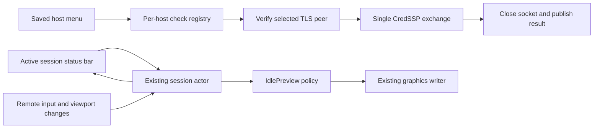

# Saved credential test and manual display pause

## Overview

The saved host’s menu gains **Test credentials**. The connected desktop’s existing status bar gains **Pause display**. Each action has its own lifetime. Credential evidence belongs to one revision of a saved host. A manual pause belongs to one connected session and never changes its host profile.

## Boundary Commitments

### This Spec Owns

The credential probe, its temporary result, the status bar control, manual suppression and transitions back to interactive graphics belong here. The existing automatic idle policy stays responsible for deciding whether a five-minute idle trial saves bandwidth.

### Out of Boundary

Reachability tests, desktop admission, general certificate enrollment UI, clipboard format changes, drive grants, sync and new codecs have separate owners. A successful test can cause normal server authentication audit events and a bad password can count toward the host’s lockout policy.

### Allowed Dependencies

Use the existing saved-host store, OS credential store, IronRDP connector and session actor. Share the peer identity contract with folder sharing through `rdp/peer_identity.rs`. Trust in an endpoint and permission to share a directory are independent. Either feature can ship first. [Folder-sharing specification](../rdp-folder-sharing/requirements.md)

### Revalidation Triggers

Recheck the probe boundary when upgrading IronRDP, SSPI or TLS, changing the credential store or adding an authentication mechanism. Recheck display transitions when changing input ownership, graphics completion signals, suppress-output negotiation, reactivation, or status bar layout.

## Architecture and system flows

## Components and interfaces

### Saved-host credential probe

The Tauri command `test_saved_credentials(connectionId)` accepts only a saved host ID. Resolve the endpoint, domain, user and credential reference in Rust. Keep one in-flight attempt per host revision in a process-local registry. The first activation starts the deadline and returns a shared result to all waiters. UI state is `Unchecked`, `Checking`, `Accepted`, `Rejected` or `Unable to verify`. Return only the host ID, opaque revision, outcome and an allowlisted reason. Render the selected host’s name and outcome with text and an accessible live region as well as the requested colors.

Start one 30-second deadline before store lookup. Resolve the address and connect to the selected endpoint. Negotiate X.224 for NLA and authenticate the peer on that same TLS stream. Verify handshake signatures and either a trusted chain with the configured hostname or IP SAN, or an already trusted, endpoint-bound SHA-256 SPKI pin. Bind the observed key to the canonical host and port. Unknown or changed identity returns gray before the probe sends a saved credential. A folder grant is never needed. Use the saved identity and secret only, with no reconnect, downgrade, redirected-host retry or alternate credential. Stop after the CredSSP exchange and close the socket before publishing. The probe never invokes `connect_finalize`, allocates a desktop session ID, joins channels or starts MCS or graphics.

| Observed on the authenticated test stream | UI outcome |
| --- | --- |
| Saved-identity CredSSP exchange followed by a valid HYBRID_EX Early User Authorization Result `Success` | Green **Accepted** |
| A decoded server TSRequest reports an allowlisted credential rejection such as `STATUS_LOGON_FAILURE` or `STATUS_WRONG_PASSWORD` during this exchange | Red **Rejected** |
| HYBRID completes upon sending the final client token, with no positive server result | Gray **Unable to verify**. The server did not confirm the credential. |
| Early authorization `AccessDenied`, policy restriction, other NTSTATUS, malformed reply, SSPI-local error or disconnect | Gray **Unable to verify** with a reason specific to the available evidence. Authorization denial alone cannot identify a bad password. |
| Missing secret, untrusted peer, interactive-only method, unsupported negotiation, timeout or unreachable endpoint | Gray **Unable to verify** with the corresponding reason |

Drive the pinned public `CredsspSequence` after `connect_begin` on the verified TLS stream. Capture `TsRequest.error_code` from a decoded server message at the receive boundary. The stock async helper returns `()` and loses that context. Classify typed messages before passing them to the next SSPI step. Use established SSPI and connector encoding and decoding. An unrecognized or unobservable response stays gray. [Protocol and pinned source findings](research.md)

For a self-signed lab host, the gray result can offer **Review server identity** as a separate host action. Show the endpoint and SHA-256 public-key fingerprint from a credential-free handshake so the operator can compare it with the administrator's value. Explicit confirmation saves the pin for that host and port in private application data, outside exported host profiles. The operator can then run the test again. A changed key shows the previous and observed fingerprints and requires fresh confirmation. The same pin store and review action serve folder sharing.

Start profile or credential mutations by invalidating the old revision and cancelling its probe. Serialize admission and snapshot publication with relevant mutations per host, including deletion, replacement/import and keyring writes. Hold no store lock across network I/O. If a partial save fails, reload the effective saved identity before admitting the next test. After completion publish only if the revision still matches. The frontend also drops stale completions after edit, deletion or reload. The deadline or cancellation closes the probe socket and prevents later protocol writes. If a blocking keyring read outlives cancellation, its result is discarded. Do not format SSPI/TLS errors, tokens, raw PDUs or the credential for UI, logs or exports. Suppress protocol token dumps even in verbose diagnostics. No disk schema changes are required.

### Manual minute previews

Extend `IdlePreview` with a session-only manual override and track negotiated suppression support independently of the saved auto-preview preference. The session actor remains the sole writer. Expose manual state, capability, an optional unavailability reason and the last completed desktop paint timestamp in the existing session-info event. Update that timestamp for real completed desktop paints even with automatic mode off. Cursor updates, clipboard events, timer ticks and requested previews do not make the image newer.

| Event | Actor behavior |
| --- | --- |
| Pause while connected and supported | Immediately suppress output, retain the framebuffer and set manual mode. Adopt an already suppressed interval without a duplicate write. End any open automatic preview and start the manual cadence. |
| Minute deadline | Allow updates for the current desktop bounds for the existing two-second window, then suppress again. Keep approximately 60 seconds between preview openings, even on a quiet or costly screen. Coalesce overdue ticks. |
| Explicit resume or first deliberate remote key, button, wheel or paste | Clear manual mode, allow updates if currently suppressed, then forward the triggering action exactly once through the normal ordered input path. During an already open preview, continue live. Restart automatic idle timing using the saved preference. |
| Pointer movement alone, local control, focus change or bar visibility change | Keep manual mode. Preserve pointer forwarding and existing local input ownership. A dedicated view-return signal preserves current automatic wake behavior without treating focus as explicit manual resume. |
| Resize or graphics reactivation | Keep manual intent while normal smart resize negotiates the latest size. If a redraw is required, coalesce resize requests and temporarily allow the new bounds. Close the redraw window after a completed new-size paint or the bounded preview window. Retain the last valid image and its age until a new paint arrives. |
| Capability missing or withdrawn | Keep or restore live output using the active negotiated share when possible. Clear manual mode and expose a reason. If the transport itself fails, use the existing disconnect path. |
| Disconnect or replacement | Discard override, transient timers and timestamp. On reconnect, construct a fresh policy from the host’s saved settings and newly negotiated capability. |

Suppress Output has no positive acknowledgment. Check the negotiated flag at activation and reactivation. For a peer that advertises the flag but keeps streaming, count completed desktop paints only while continuously suppressed. Ignore in-flight updates in the first two seconds, redraws, preview windows, cursor changes and other channel traffic. Three consecutive two-second intervals with desktop paints (about eight seconds including the grace period, user decision 2026-11-18) provide evidence to fall back to live with “Host continues sending display updates.” Reset the observation on a new suppression interval. Quiet screens and an expensive requested preview are never evidence of refusal. Exercise the threshold with a fake clock before real-host validation.

`pause_display(sessionId)` and explicit `resume_display(sessionId)` are idempotent. Confirm state through the actor, reject a stale session ID and keep controls scoped to the selected tab. The actor keeps servicing network reads, graphics acknowledgements, clipboard transfers and Resync during suppression. Resize, Resync, and local release of keys formerly forwarded to the remote session must not act as deliberate wake input. Preserve release ordering so a local menu activation cannot leave a modifier held remotely. Separate remote paste from background clipboard synchronization. The existing status bar uses its current auto-hide delay and measured viewport. Show **Resume live** and age or “Last update unknown” inside that same bar. On unsupported connected sessions, show the disabled control with an accessible reason.

## File Structure Plan

| Location | Responsibility |
| --- | --- |
| `src-tauri/src/rdp/credential_probe.rs` (new), `rdp/client.rs`, `rdp/peer_identity.rs` (shared) | Isolate the NLA-only driver, reuse negotiation and verified TLS on the same socket. The shared module owns endpoint pins, uses the existing atomic store writer and returns the verified identity to either feature. |
| `src-tauri/src/commands/connection.rs`, `store/credentials.rs`, `lib.rs` | Register the command, coordinate keyring/profile revisions and scoped state. |
| `lib/tree-menu.ts`, `components/layout/ConnectionTree.tsx`, `lib/tauri.ts`, `types.ts` under `src` | Host menu activation, pending/result state, IPC and accessible announcements. |
| `src-tauri/src/rdp/idle_preview.rs`, `rdp/session.rs`, `commands/session.rs` | Manual transitions, input classification, wire ordering, capability and session-info projection. |
| `components/layout/StatusBar.tsx`, `components/session/SessionView.tsx`, `components/session/canvas-keyboard.ts`, `lib/idle-preview.ts`, `stores/sessionStore.ts` under `src` | Per-session status, focus handling, keyboard ownership and age rendering. |

## Requirements traceability and testing strategy

| Requirements | Evidence to obtain during implementation |
| --- | --- |
| 1.1, 1.2, 1.6, 1.7 | Counting test transport and delayed keyring. Repeat activation while pending. Assert one exchange, one deadline covering lookup, socket closed before result, no MCS bytes, no registry changes to an active desktop. |
| 1.3, 1.4, 1.5 | Protocol fixtures for valid HYBRID_EX success, explicit wrong password, generic access denied, plain HYBRID final send, invalid TLS chain/signature/pin, missing secret, timeout and interactive sign-in. Assert color, text and proof source. |
| 1.8, 1.9, 1.10 | Keyboard activation and screen-reader announcement identify the host. Use a sentinel secret with verbose diagnostics and exported host data. Race completion with edits, deletion and failed credential replacement. |
| 2.1, 2.2, 2.3, 2.4 | Use a virtual clock with auto off and on, static and busy frames, two simultaneous sessions and at least two preview cycles. Check graphics writes, framebuffer age, continued channel reads, clipboard Resync and frame ACKs. |
| 2.5, 2.6, 2.9 | Record wire order and input counts for click, key, wheel and paste. Exercise pure pointer motion, tab focus, menu keyboard release, status-bar reveal/hide, resize and reactivation while suppressed and during a preview. |
| 2.7, 2.8 | Withdraw the capability and disconnect in each graphics state. Assert reason, fresh state on reconnect and isolation from a second session. |

Run focused frontend tests and native Windows Rust nextest plus doctests. Follow with a Windows-client test against an authorized real host with a known outcome, including typing after pause, resizing, local menu use and clipboard Resync. Use a controlled test identity for denial validation. Record the negotiated protocol, bounded duration, visual state and whether live input resumed. Report real-host evidence separately from fixture evidence. See [research and remaining validation](research.md).
